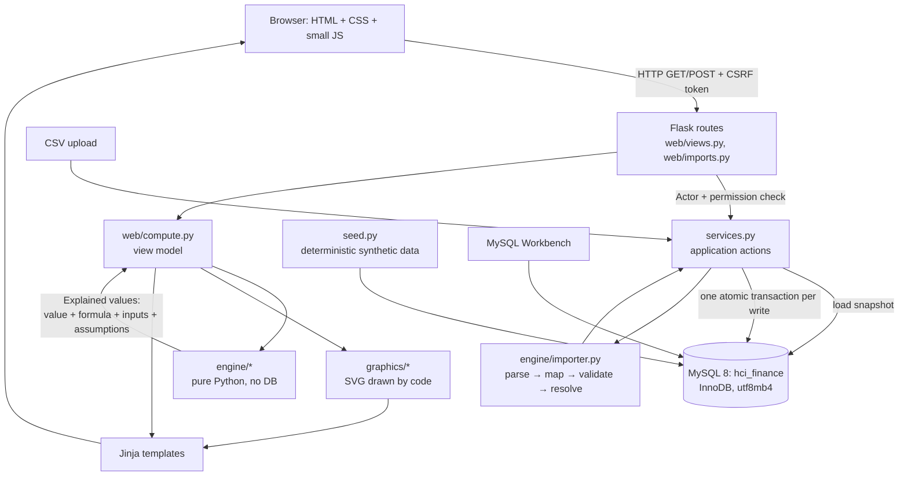

# Architecture

## 1. Modules and data flow



| Layer | Responsibility | Knows about the database? |
|---|---|---|
| `engine/` | Money, dates, recurring bills, forecast, budgets, goals, what-if, import analysis, validation | **No**: unit-testable with hand-made data |
| `graphics/` | SVG cash-flow chart, budget bars, variance chart | No |
| `services.py` | Permissions (`Actor.can`), every database read/write, import journal, undo/redo, audit log | Yes |
| `web/` | HTTP routes, forms, redirects, view model | Through services only |
| `db.py` | Table definitions; MySQL DDL exported to `db/schema.sql` | Yes |

## 2. The engine ("explain this number")

Every figure shown to a person is an `Explained` object: `value`, `kind` (actual / forecast / actual + forecast / plan),
`formula`, `inputs`, `assumptions`. Templates show the value with a badge whose **shape** marks its kind, and a
native `<details>` panel with the working. The panel is collapsed in the Summary lens and open in the Detailed lens.

**Forecast** (`engine/forecast.py`):

```
balance(d) = opening balance (dated) + Σ posted transactions up to the cut-off ("as of")
           + Σ recurring income/bills due after the cut-off and not yet posted
           − variable spending × days
variable spending per category = min / median / max of the last 3 full months  → best / typical / worst
```

* Only an explicit link (`recurring_id` + `occurrence_date`) marks a bill as paid. A look-alike payment is a *suggestion*: it is still projected and labelled until confirmed.
* Transactions explained by a bill are excluded from variable spending, so bills are never counted twice.
* With fewer than two full months of history the forecast is a *limited estimate*, and the person can enter their own monthly figure.
* What-if scenarios work on copies and never touch the ledger.

## 3. Import pipeline and undo (Week 12 change request)

1. **Upload**: size, encoding and CSV structure are checked (strict parser). A fatal problem gets a recovery message, and nothing is stored.
2. **Map**: columns, sign convention and day/month order. Guesses are pre-filled *with evidence* and must be confirmed.
3. **Resolve**: each row is *ready*, *needs a decision* (ambiguous date, duplicate candidate, future date, odd refund sign) or *has an error*, and every row shows its line number and original values. Commit stays blocked until every row is resolved; a generic "import" choice cannot override an unresolved date.
4. **Commit**: one database transaction writes the inserted rows (each with its raw CSV row and the mapping), the batch record and the journal. A failure rolls back everything.
5. **Undo**: rows are locked (`SELECT … FOR UPDATE`) and their versions re-checked. Rows edited after the import force an explicit choice: a *partial* undo (keep edited rows, labelled "partly undone") or a *full* undo. Removed rows are journalled with a before-image, so **redo** can restore them exactly.

## 4. Roles and permissions

| Action | Owner / household manager | Coach (summary grant) | Coach (full grant) |
|---|---|---|---|
| View dashboard, budgets, forecast, what-if | ✓ | ✓ | ✓ |
| View transactions, export transactions, see detailed activity | ✓ | ✗ | ✓ |
| Edit anything, import, undo | ✓ | ✗ | ✗ |
| Manage coach sharing | household only | ✗ | ✗ |
| Coach notes | ✗ | ✓ | ✓ |

Every write also checks `version` (optimistic concurrency). Two household editors saving the same budget get a
comparison screen instead of a silent overwrite.

## 5. What is simulated

Synthetic data; coach sharing between in-app demo profiles; storage failure (Settings toggle). There is no real
authentication, bank connection, e-mail or notification delivery.

## 6. Computer Graphics component

`graphics/cashflow.py` draws the cash-flow chart as SVG:

* **Scales**: linear value scale with "nice" 1-2-5 ticks. The y-range is inverted because SVG's y axis grows downward.
* **Transforms**: `translate()` to the plot area, `rotate(45)` for the hatch pattern, and `getScreenCTM().inverse()` in JS to map the pointer back into chart space.
* **Encoding**: solid = actual, dashed = forecast, hatched band = best–worst range, dotted = what-if, and a labelled "As of" rule. Colour is never the only cue, and lines are labelled directly.
* **Honesty**: the y-axis always includes zero (the misleading truncated-axis variant was rejected).
* **Accessibility**: `<title>` and `<desc>`, keyboard reading with ←/→/Home/End through an `aria-live` region, a full table alternative, and a reveal animation that is switched off under reduced motion.
